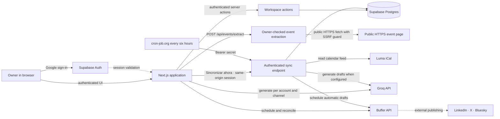
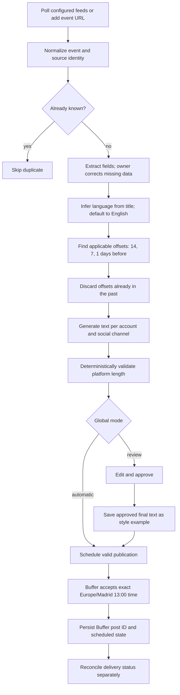

# Architecture and workflow

## Research record

The repository at the start of this workstream contained a Next.js starter and the agreed product specification. The diagrams below describe the intended system boundaries; they are not evidence that the external integrations are already configured or running.

## System context

The browser contains no provider secrets. Workspace writes go through Next.js Server Actions, and event extraction goes through `POST /api/events/extract`; both verify the Google-authenticated owner when Supabase is configured. Local demo mode permits extraction without an account for local use. Supabase RLS independently scopes persisted rows to the owner. Approval and style-example insertion use a transactional database function. Persistent event creation and newly imported Luma events use Groq when its server configuration is present; the sync endpoint imports Luma events and leaves them saved without drafts when Groq is unavailable. `POST /api/cron/sync` accepts either the configured cron bearer secret or a same-origin request from the authenticated owner; both paths use the server-only Supabase service-role key after authorization. Meetup polling and confirmation of actual social publication are not implemented. Buffer scheduling is implemented and tested with mocks; provider credentials and channels still require real-world validation. Manual extraction fetches public HTTPS event pages (with SSRF protection against private IP ranges and internal hostnames), parses available schema.org JSON-LD, HTML metadata, and heuristic date/time/location markers, caps the response at 1 MB, and leaves missing fields for owner review.

## Event-to-publication lifecycle

An idempotency key should be based on event identity, Buffer account/channel and reminder offset. Persist an intent before calling Buffer. If a request times out after Buffer may have accepted it, reconcile against Buffer before retrying, since blindly repeating a create request can duplicate a post. A `scheduling` attempt cannot be marked missing while it may still be active; responses are fenced by a persisted attempt ID. An orphaned `scheduling` claim cannot safely be released solely because time has elapsed. Approval stores the final edited text as an example in the same action. Posts generated in automatic mode are not approved examples.

## Calendar

All event and publication times use `Europe/Madrid` and 13:00 for scheduled reminders. The two-week default is the current Monday-based week plus the next week. Week and natural-month views use the same data and status source. Entries should show the event, account, channel, scheduled time and current state. A Buffer schedule acceptance is distinct from a post being sent successfully.

## External service boundaries

| Service | Intended responsibility | Configuration / limitation |
| --- | --- | --- |
| Supabase | Google sign-in and Postgres persistence | Free projects can be paused after low activity; test restoration/availability expectations before relying on it. |
| Groq | Generate candidate copy from account prompt and relevant approved examples | API limits vary by account/model; generation must be bounded and failures kept visible for retry. |
| Buffer | Schedule and report per-channel posts | API key and connected channels are required. Verify three accounts, permissions, plan and channel-specific constraints before enabling automatic mode. |
| Luma | Publish event calendars and provide iCal subscription URLs | Test a real feed for field completeness and refresh behavior before treating it as a reliable source. |
| Public event pages | Manual URL extraction for individual events | Best-effort public HTML metadata, JSON-LD, and heuristic markup parsing for any public HTTPS event URL with SSRF guards; no recurring sync or proprietary API integration. Provider markup can change, and missing fields require owner correction. |
| cron-job.org | Invoke the authenticated sync route every six hours | Configure HTTPS endpoint and Bearer secret; account schedule accuracy and service availability should be checked before production reliance. |

## Cost and hosting decision

The design avoids extra paid infrastructure and can start with free tiers where their terms and limits fit. Current Supabase documentation describes a Free plan, with project pausing after a week of low database activity. Vercel Hobby is free but restricted to personal or non-commercial use. Because this application supports association communications, confirm eligibility with Vercel or select an eligible host before production deployment; do not treat Hobby as an approved zero-cost production assumption. External API usage and Buffer account requirements may also incur costs.

- [Vercel Hobby plan and use restrictions](https://vercel.com/docs/plans/hobby)
- [Vercel terms for Hobby usage](https://vercel.com/legal/terms)
- [Supabase free project pausing](https://supabase.com/docs/guides/platform/free-project-pausing)
- [Groq rate limits](https://console.groq.com/docs/rate-limits)
- [Buffer API](https://developers.buffer.com/)

These provider notes were checked on 2026-10-31 and may change. Re-check account terms and limits before deployment.

## Failure handling

- Reject or hold an event when required date/title data cannot be confirmed.
- Do not schedule a reminder whose 13:00 Madrid time has passed.
- Keep invalid-length copy out of Buffer and show validation feedback so the owner can edit or regenerate it.
- Make sync safe to invoke repeatedly and concurrently with database uniqueness/locking.
- Preserve the intended post and provider response state when Buffer/Groq requests fail; do not silently mark work published.
- Treat date changes and cancellations as manual operations in this first phase. Existing scheduled posts may need manual cancellation or edits in Buffer.
